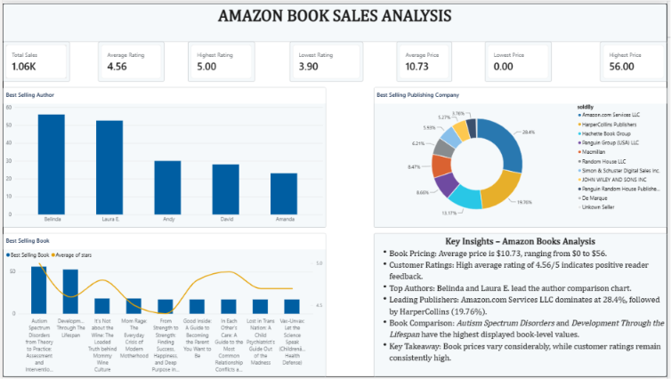
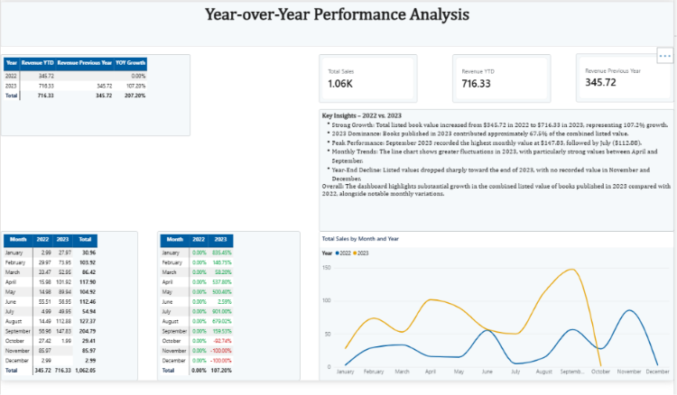

# Amazon Books Pricing & Publication Analysis

## Project Overview
This project uses Power BI to analyze Amazon book listings, focusing on pricing, customer ratings, publisher distribution, and publication trends between 2022 and 2023.

## Tools & Technologies
- Power BI Desktop
- Power Query – Data cleaning and transformation
- DAX – Calculated measures and time intelligence
- Microsoft Excel – Data preparation

## Data Cleaning
- Handled missing seller information
- Standardized text fields
- Cleaned and formatted publication dates
- Created price and rating categories
- Calculated book age

## Key Insights
- Total listed book value: **$1,062.05**
- Average book price: **$10.73**
- Average customer rating: **4.56/5**
- Listed book value increased by **107.2%** between 2022 and 2023.
- Amazon.com Services LLC represents the largest share in the publisher comparison at **28.4%**.

## Dashboard Pages

### 1. Pricing & Ratings Overview

### 2. Year-over-Year Analysis

## Skills Demonstrated
Power BI | DAX | Power Query | Data Cleaning | Time Intelligence | Data Visualization | Business Analytics

## Data Limitations
This dataset contains book prices and publication dates rather than actual sales transactions. Therefore, the analysis represents listed book value, not verified sales revenue.
